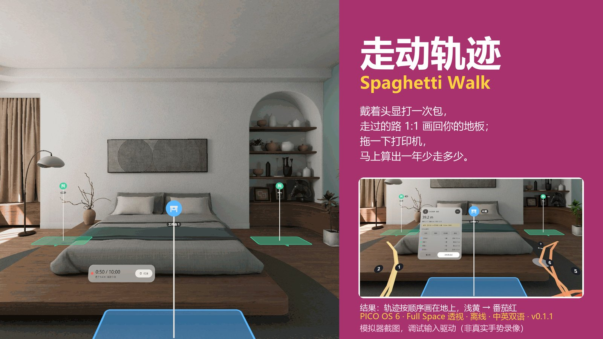
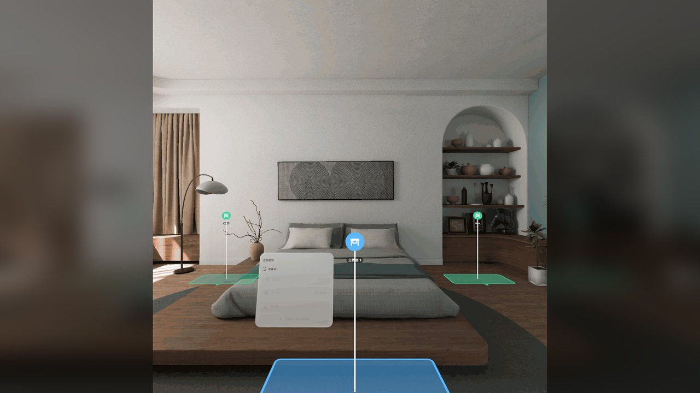
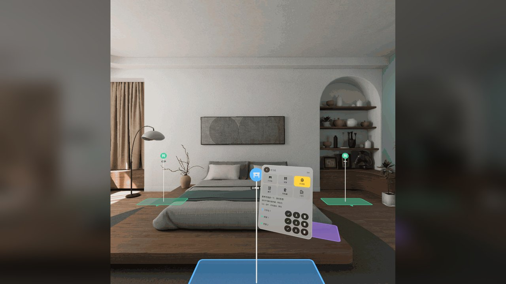
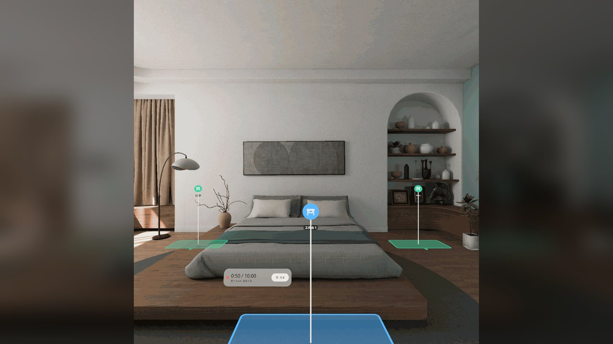
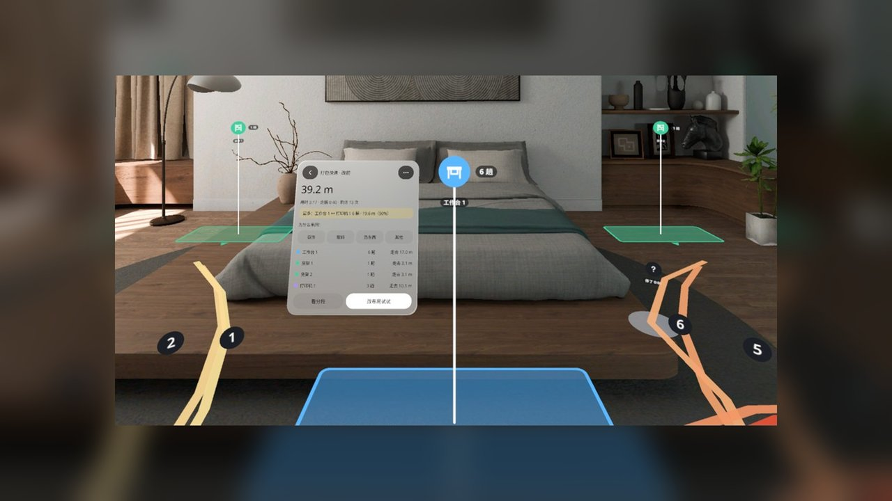
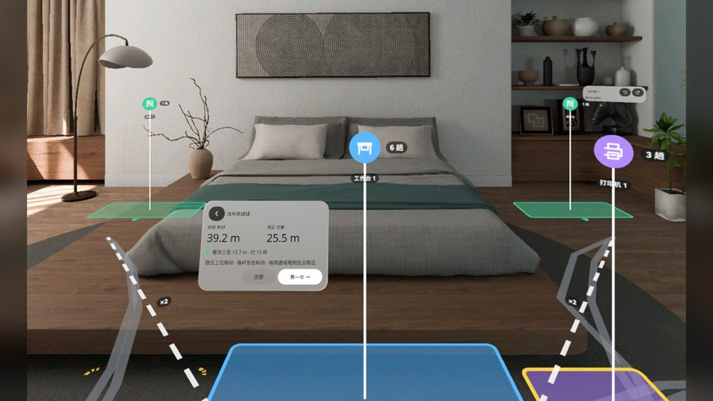
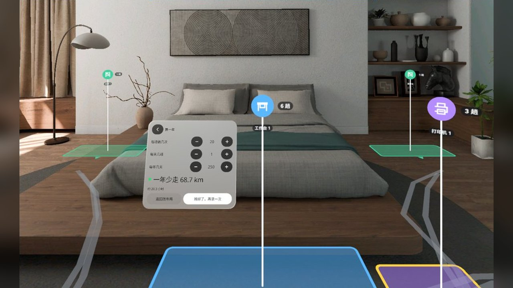

# 走动轨迹 · Spaghetti Walk

[中文](#中文) · [English](#english)



> PICO OS 6 · PICO Spatial SDK 6.1.9 · Full Space（透视 Mixed Stage）· 离线 · 中英双语 · v0.1.1
> 本页截图均来自 PICO 6.1 模拟器，由调试输入驱动，**非真实手势录像**。

---

## 中文

### 这是什么

精益里的「意大利面图」搬进你自己的房间：先在地上钉好工作台、货架、打印机这些**工位标记**，然后戴着头显照平时的样子**打一次包**（或整理一次）。结束后，你走过的路按顺序 **1:1 画在你的地板上**，分段编号、浅黄到番茄红；面板告诉你总共走了多少米、在哪两处来回最多。把打印机标记**拖到台边**，立刻算出每次少走几米、一年少走多少公里；真把东西搬过去再录一遍，就有同口径的「改后实测」。

一次研究约 15 分钟。除了「录一次」要走，其余操作全部原地完成；不想走也可以看内置的**示例动线**。

### 怎么用

1. **钉工位**：工位盘选类型（工作台 / 货架 / 打印机 / 柜子 / 垃圾桶 / 门口，最多 8 个），注视地面捏一下，或手柄射线指地面扣扳机。选中的工位可用摇杆左右转、⟲ ⟳ 微调、删除。
2. **录一次**：选任务（打包快递 / 整理文件 / 收拾工作台 / 其他），3 秒倒数后开始；头显 10 Hz 记下你在地面的投影，在工位旁停 ≥ 1.2 s 算一次到访。做完放下东西捏「结束」，最长 10 分钟。
3. **看结果**：轨迹按顺序画回地板，每个工位挂趟数牌，没钉工位却停留过的地方出灰色问号（可就地标成工位重算）。「看分段」逐段点亮。
4. **改布局试试**：捏住（或按住扳机）拖一个工位，靠近台边 / 原位虚线框会吸住；面板实时显示「改前实测 vs 改后估算」。「算一年」按每班次数 × 班次 × 天数折算。
5. **改后实测**：搬好东西再录一次，三列对比：改前实测 / 改后估算 / 改后实测。

扫不到地面时 5 秒后自动用 6 × 5 m 虚拟地面（可调长宽高低）。工位和两次录制存本机，下次打开用世界锚点找回。

### 截图

| | |
|---|---|
|  首页：三个大按钮，钉好 2 个工位才能录 |  钉工位：工位盘 + 地上的轮廓和图标牌 |
|  录制中：计时、走了几米、到访几次 |  结果：轨迹 1:1 画在地上，浅黄 → 番茄红，段号 + 趟数牌 |
|  改布局：打印机吸到台边，改后估算 25.5 m |  算一年：一年少走 68.7 km |

（结果 / 改布局 / 算一年三张取自 QA 报告拼图，分辨率较低。）

### 安装

Release 里的 APK 就是在 PICO 头显（Swan B3110）上验证过的那一个（debug 构建，sha256 见 Release 说明）。

```bash
adb install -r SpaghettiWalk-v0.1.1.apk
pico-cli app launch io.embodit.spaghettiwalk
```

或用 adb 启动：`adb shell monkey -p io.embodit.spaghettiwalk -c android.intent.category.LAUNCHER 1`。
要求 PICO OS 6（minSdk 35）、Full Space；无运行时权限、不联网、不需要账号。

### 从源码构建

```powershell
$env:JAVA_HOME = "<JDK 21>"      # 例如 pico-cli 自带的 ~/.pico/primer-cli/jdk/jdk-21.0.12.1+1
.\gradlew.bat assembleDebug testDebugUnitTest
```

调试广播（`io.embodit.spaghettiwalk.DEBUG`：`seed`、`walk a|b`、`state Sxx`、`stick`、`time`、`lost`…）和 QA 截图清单见 [AGENTS.md](AGENTS.md)。

### 版本

- **v0.1.1（2026-10-28）**：再短的一次录制也能出结果。去掉了 v0.1.0 的「太短了」门槛，哪怕按下开始就结束也进结果页；几乎没动的录制在原地画一个小圈，结果面板加一行提示。
- **v0.1.0（2026-10-27）**：首版。S00–S30 全部状态、调试广播、示例动线、虚拟地面；模拟器 QA #1 通过（33 态 50 张截图，门禁全过，0 打回）。

### 已知问题（不影响使用，来自 QA #1）

1. 「只看数字」视图里「最多的来回」显示内部 ID（wb1 ↔ pr1）而不是工位名。
2. 工位小条固定大小，工位在 2.5–3 m 外时字小、按钮难按（摇杆和工位列表仍可用）。
3. 英文界面下原因按钮被截断（「Fetch s…」「Throw …」）。
4. 用调试命令从改布局直跳别的状态后，地上可能残留黄色台边虚线框。
5. 主面板懒跟随：转身再转回来时面板可能停在视野一侧，挡住一个名字牌；转头即可。
6. 刚进改布局还没动工位时，改后估算显示 38.7 m 而不是实测的 39.2 m。
7. 前后对比中间列「25.5」下面多出一个孤立的「m」。
8. 录制小卡副行小字对比度约 4.1:1，略低于 4.5:1。
9. 「已有 8 个工位、类型格子禁用」这一变体调试钩子到不了，没有截图（代码里有上限判断）。
10. 测试贴图模式下牌子文字被裁（只在测试模式出现）。
11. 研发站没有出 `build/ui-audit.md`，遮挡清单以 QA 报告为准。

### 真机未覆盖 / 待验证

用户已在头显上确认 v0.1.1 可用（2026-10-30）。模拟器测不到、真机也还没系统验证的：真人走路噪声与到访判定阈值、眼动注视 + 捏合放置精度、真手柄摇杆手感、锚点跨天找回、面条和牌子在真实地板 2–3 m 外的可读性。

### 链接

- PRD：https://claude.ai/artifact/43jbXXBoitxEJJsdhg8X7w（私有）
- 样稿：https://claude.ai/artifact/HjLnvPZte2JN1cwD4eo9pC（私有）
- QA 报告 #1：https://claude.ai/artifact/TLUGZxDqasJJ5ZWPpxy7LC（私有）
- Release：https://github.com/kejing-dev/SpaghettiWalk/releases/tag/v0.1.1

### 许可

私有仓库，保留所有权利。随包字体 Noto Sans / Noto Sans SC 为 SIL OFL 1.1（见 `third_party/`）。由黑灯工厂（spatial-app-factory）用 Claude Code 生产。

---

## English

### What it is

A lean "spaghetti diagram" in your own room. Pin **station markers** (workbench, shelf, printer, cabinet, bin, door) on your floor, then **pack one parcel** the way you normally do while the headset logs where you walk. When you stop, the path is drawn **1:1 on your floor**, in numbered segments from light yellow to tomato red, and the panel shows how far you walked and which two stations you shuttled between most. **Drag the printer marker to the bench end** and the saving per run and per year appears at once; move the real thing and record again for a measured After.

One study takes about 15 minutes. Only "Record a run" involves walking; everything else works from where you stand, and a built-in **example run** needs no walking at all.

### How to use

1. **Pin stations**: pick a type on the tray (up to 8), look at the floor and pinch, or point the controller ray and pull the trigger. A selected station turns with the thumbstick or the ⟲ ⟳ buttons.
2. **Record a run**: choose a task, a 3-second countdown, then work as usual. Head position is sampled at 10 Hz; standing by a station for 1.2 s counts as a visit. Pinch Stop when done (10 minutes max).
3. **Results**: the path is drawn back on the floor, each station gets a trips badge, unmarked stops show a grey "?" you can turn into a station. "Segments" lights them one by one.
4. **Try a new layout**: pinch-and-drag (or hold the trigger) a station; it snaps to the bench-end or original-spot frames. The panel shows Before (measured) vs After (estimate); "A year of this" scales it by runs × shifts × days.
5. **Record the After run**: move the real things, record again, compare three columns.

No floor found within 5 s → a 6 × 5 m virtual floor you can resize. Stations and both runs are saved on the device and restored through a world anchor.

### Screenshots

See the table above: home, pinning stations, recording, results on the floor, snapped layout, yearly saving. All captured on the PICO 6.1 emulator with debug-injected input, **not real hand-gesture recordings**. The three result/layout images are low-resolution crops from the QA report.

### Install

The Release APK is the exact build verified on a PICO headset (Swan B3110) (debug build; sha256 in the release notes).

```bash
adb install -r SpaghettiWalk-v0.1.1.apk
pico-cli app launch io.embodit.spaghettiwalk
```

Requires PICO OS 6 (minSdk 35), Full Space. No runtime permissions, no network, no account.

### Build

```powershell
$env:JAVA_HOME = "<JDK 21>"
.\gradlew.bat assembleDebug testDebugUnitTest
```

Debug broadcast (`io.embodit.spaghettiwalk.DEBUG`) and the QA screenshot list are documented in [AGENTS.md](AGENTS.md).

### Versions

- **v0.1.1 (2026-10-28)**: no run is too short. The "too short" gate is gone; any run goes to its result, a run that barely moved draws a small ring, and the result panel carries a hint line.
- **v0.1.0 (2026-10-27)**: first build. All states S00–S30, debug broadcast, example run, virtual floor; emulator QA round 1 passed.

### Known issues (from QA #1, none blocking)

Internal IDs in the numbers-only "most frequent pair" line; the station bar is small at 2.5–3 m; English reason buttons are truncated ("Fetch s…"); a bench-end frame can linger after debug state jumps; the lazy-follow panel can rest to one side after turning; the first layout estimate reads 38.7 m instead of 39.2 m; a stray "m" under the middle compare column; recording-card secondary text at ~4.1:1 contrast; the "8 stations, tray disabled" variant has no screenshot; plate text is clipped only in test-texture mode; no `build/ui-audit.md` from the build station.

### Not yet verified on a headset

The user confirmed v0.1.1 works on the headset (2026-10-30). Still unmeasured: real walking noise vs the visit thresholds, gaze + pinch placement accuracy, thumbstick feel, anchor recovery across days, ribbon and plate legibility on a real floor at 2–3 m.

### License

Private repository, all rights reserved. Bundled fonts Noto Sans / Noto Sans SC are SIL OFL 1.1 (see `third_party/`). Produced by the spatial-app-factory pipeline with Claude Code.
